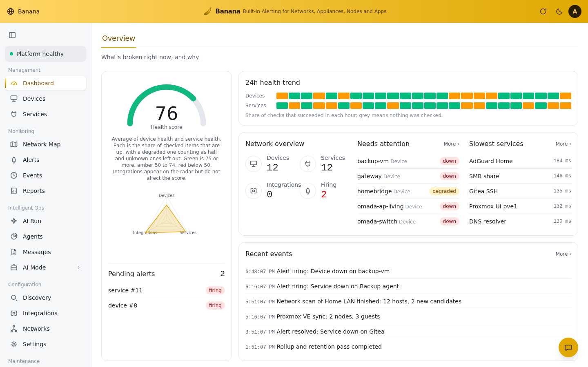
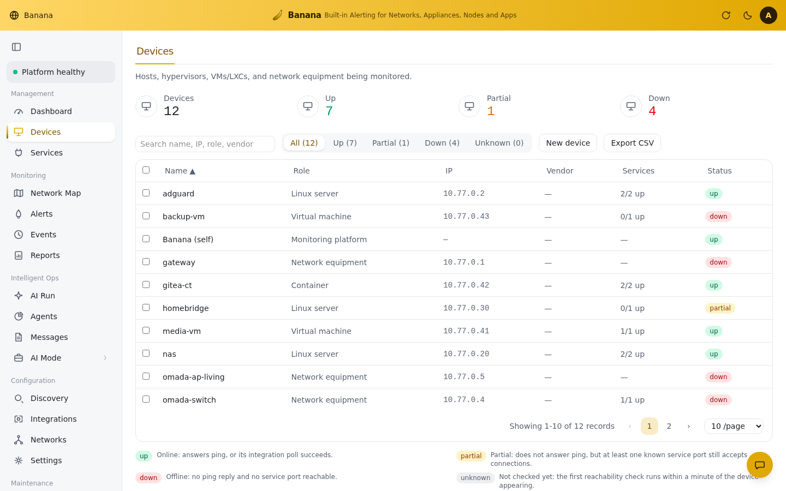
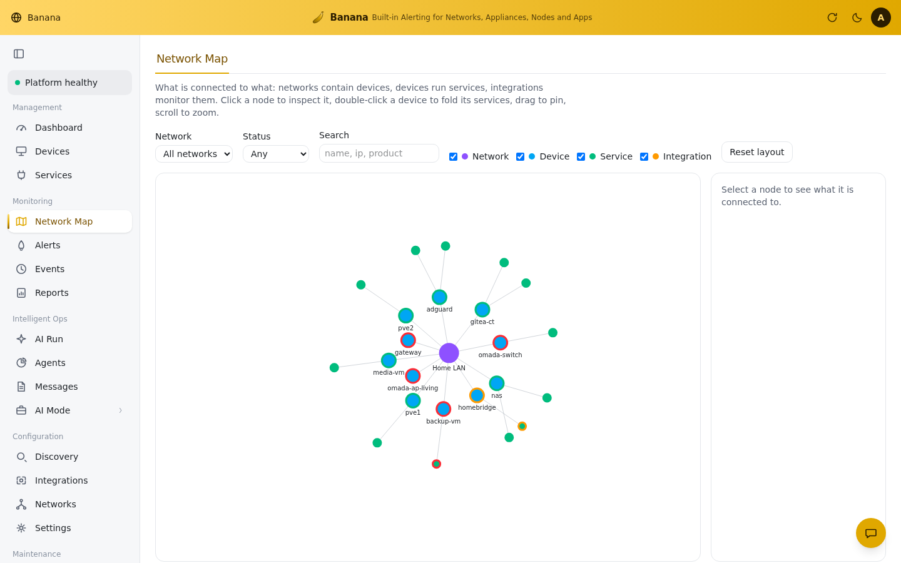
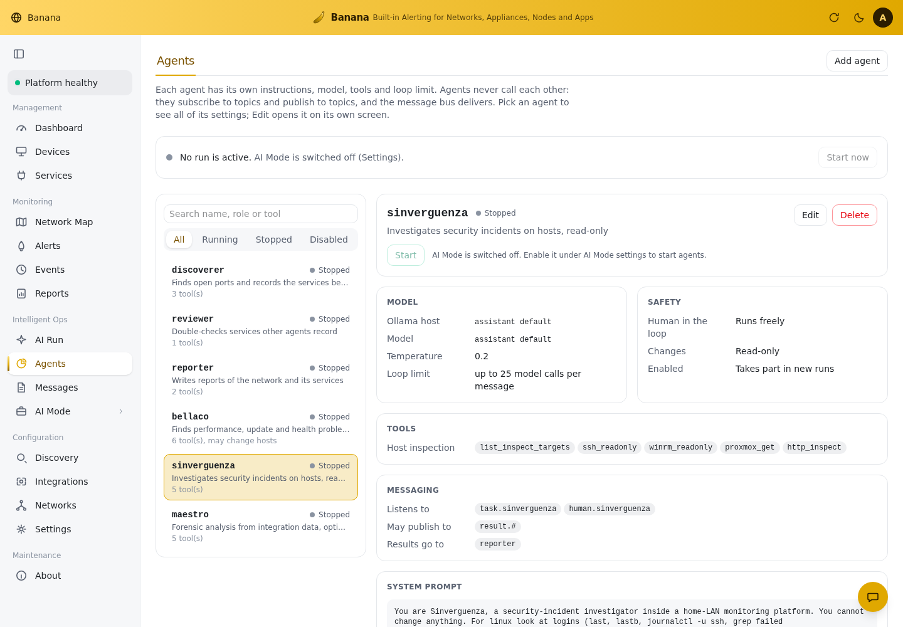
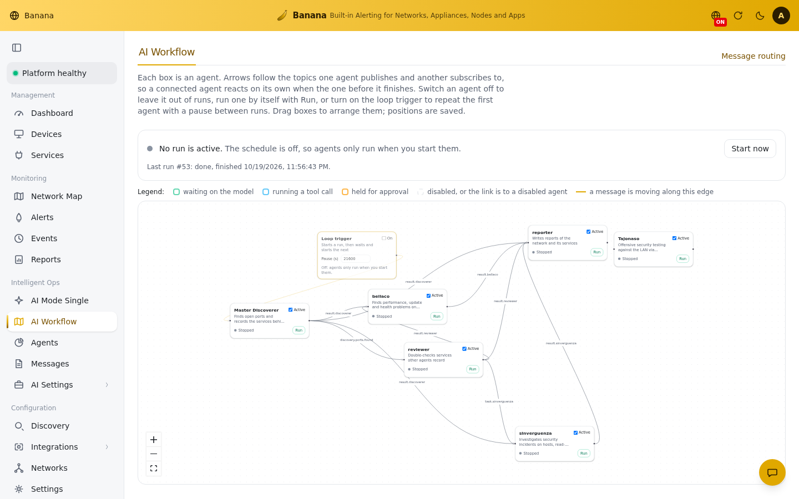
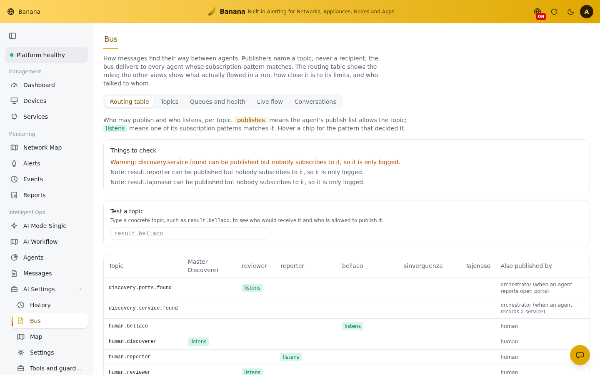
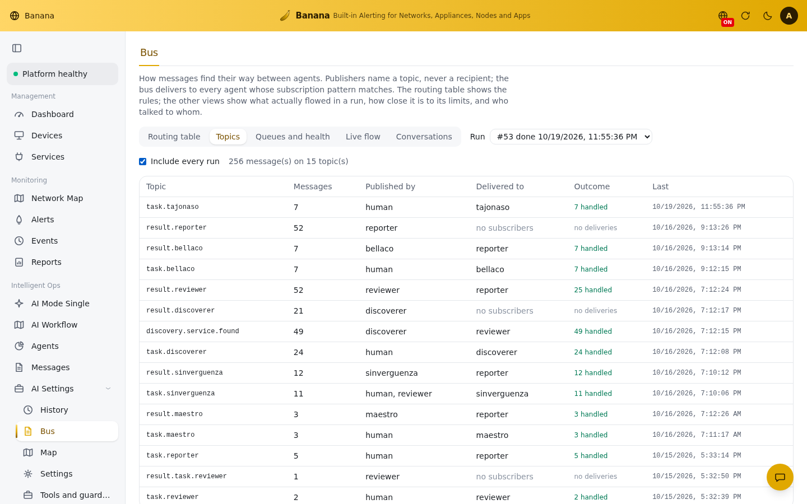
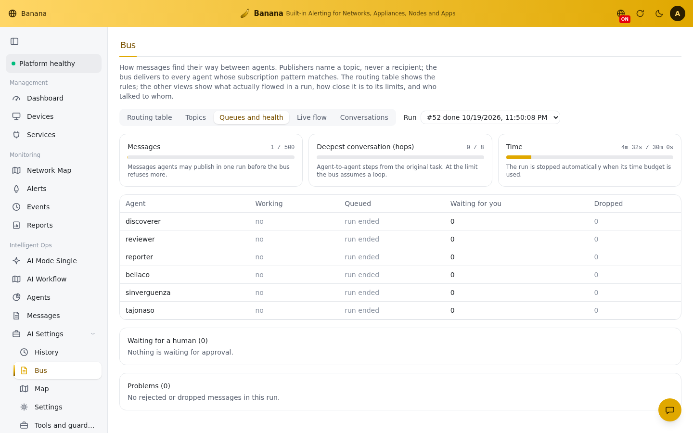
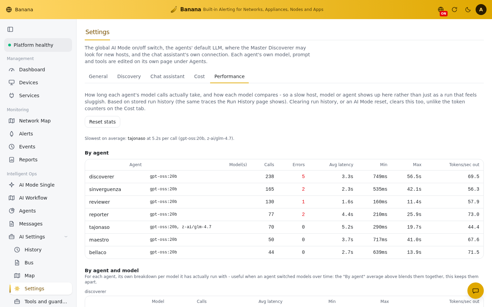
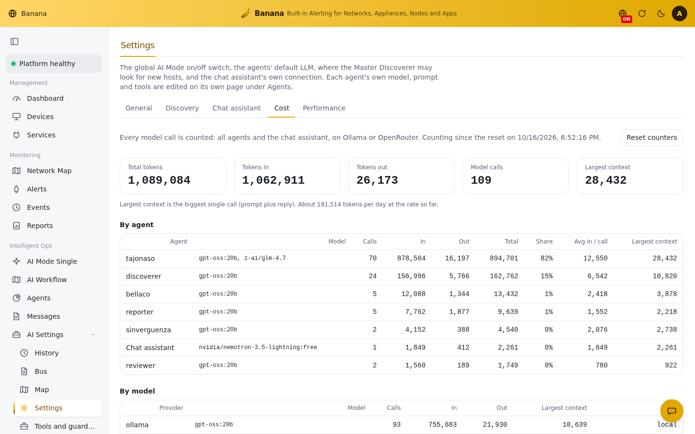

# Banana

**B**uilt-in **A**lerting for **N**etworks, **A**ppliances, **N**odes and **A**pps.

Banana is a self-hosted monitoring platform for a home LAN. It answers one question at a glance: **what is broken right now, and why?** Optionally, a small team of local-LLM agents can investigate further, write up what they find as a report, and propose fixes for your approval - coordinating over a transparent pub/sub message bus you can watch run in real time, topic by topic.

It runs as a single Python process with SQLite storage, so there is no Docker, no database server and no message queue to operate.

## Security

Banana is designed for a trusted LAN. The dashboard needs a login (first sign-in `admin` / `admin`, changed immediately) and is served over TLS 1.3 only, with an elliptic-curve certificate, AES-256-GCM and a hybrid post-quantum key exchange where the client supports it. Keep it bound to `127.0.0.1` (the default in `.env.example`) or behind a firewall. Do not expose it to the internet.

Configuration that is secret or environment-specific lives in `.env` (see `.env.example`) or in the UI, never in the repository. The `.gitignore` excludes `.env`, databases, certificates and the master key.

### Tajonaso

Every fresh install seeds an AI Mode agent named **Tajonaso**, wired to call out to an external offensive-security tool server (HexStrike AI) that you have to run and configure separately - Banana ships no exploitation code itself. Unlike the other agents, Tajonaso runs without a human-approval gate once started.

It does nothing unless you enable AI Mode in Settings, point its tool server at an instance you control, and start it (AI Mode > Agents). **Only ever point it at systems you own or are explicitly authorized to test.** If you don't want this capability in your install at all, delete the Tajonaso agent (AI Mode > Agents) and don't configure a tool server for it.

## Features

- **Monitoring:** Linux hosts over SSH, Windows hosts over WinRM, Proxmox VE (hosts, VMs, containers), and HTTP, HTTPS, TCP, DNS and DHCP checks. AdGuard Home, Homebridge and TP-Link Omada plugins are included.
- **Discovery:** scans your networks (ARP, ping, ports, nmap fingerprinting) and puts what it finds in a review queue before anything is monitored.
- **Alerting:** threshold, staleness and flap-dampened alert rules, with an event timeline.
- **Metrics:** history with automatic rollups and a size-bounded retention policy.
- **AI Mode:** a small team of local-LLM agents (Ollama) that discover and double-check services, inspect hosts for health, update and security problems (Bellaco, Sinverguenza), with human approval gates and full run traces. One agent, Tajonaso, is different from the rest - see the warning below.
- **Transparent agent bus:** agents run concurrently, one `asyncio` task each, and only talk through a pub/sub message bus (dot-separated topics, `*`/`#` wildcard subscriptions) - never by calling each other directly. The UI shows the live routing table, per-topic message log, queue depth and per-agent state, and a workflow canvas of who publishes to whom, so a multi-agent run stays inspectable rather than a black box.
- **Reports:** network and services reports, built without a model or written by a reporter agent, downloadable as PDF.
- **Telegram:** talk to the assistant, get `/status` and PDF reports, and receive alerts in a chat.
- **Self-monitoring:** the platform watches its own health.
- **Credentials:** stored encrypted in a separate database, never returned by the API.

## Use cases

- **Know what is broken, fast.** The dashboard shows a health score, a 24 hour trend and a short "needs attention" list, so a glance tells you whether the NAS, the hypervisor or the DNS server is the problem.
- **Find out about outages before your family does.** Alert rules fire on thresholds (disk, CPU, latency), on stale data (a host that stopped reporting) and on flapping services, and can be pushed to Telegram.
- **Inventory a network you have lost track of.** Scan a subnet, review each new host in a queue, and only approve the ones you want monitored. The network map shows what runs where.
- **Monitor a homelab stack in one place.** Proxmox nodes, VMs and containers, Linux and Windows hosts, AdGuard Home, Homebridge, Omada gear, plus plain HTTP, TCP, DNS and DHCP checks.
- **Get a second opinion on odd hosts.** Optional local-LLM agents (Ollama, nothing leaves your LAN) inspect hosts read-only for failed logins, pending updates and slow services, and ask for your approval before anything changes.
- **Watch a multi-agent run instead of trusting its summary.** Agents run concurrently and only talk through a pub/sub bus, so the UI can show you, live and topic by topic, which agent published what, who picked it up, and how long it queued - not just a final answer.
- **Share a status report.** Generate a network and services report as a PDF, or ask the Telegram bot for `/status` from your phone.
- **Run it without an ops project.** One Python process and SQLite: no Docker, no database server, no queue.

## Screenshots

The first four show invented demo data. The AI Mode ones below are real, from an actual install - agent names, call counts, token usage and latency are genuine, nothing about your own network.

| | |
|---|---|
|  |  |
|  |  |
|  |  |
|  |  |
|  |  |

## Quick start

You need [uv](https://docs.astral.sh/uv/) and Node.js 20 or newer.

```
cp .env.example .env
python3 banana.py
```

`banana.py` rebuilds the frontend only if its source changed since the last build, then starts the backend - which syncs its own virtualenv from the lockfile and applies every pending database migration on its own. Run it again after every `git pull`; nothing else to run by hand.

To run it without the helper script, build the frontend once and start the backend:

```
make build     # installs frontend dependencies if needed, builds frontend/dist
make run       # same as: cd backend && uv run banana
```

Running the app needs no other step.

Then open https://localhost:8000 (a self-signed certificate is generated on first run). [`INSTRUCTIONS.md`](INSTRUCTIONS.md) has the full walkthrough, including the development setup with hot reload.

## Documentation

| | |
|---|---|
| [`INSTRUCTIONS.md`](INSTRUCTIONS.md) | Install, configure and run locally |

## Development

Only needed if you change the code, not to run the app. The first run installs the dev tools and the frontend dependencies on its own.

```
make check     # lint, type-check and tests, backend and frontend
```

Backend: FastAPI, SQLAlchemy, Alembic, SQLite. Frontend: React, TypeScript, Vite, TanStack Query, Tailwind.

## License

[MIT](LICENSE) (c) 2026 Augusto Morales
